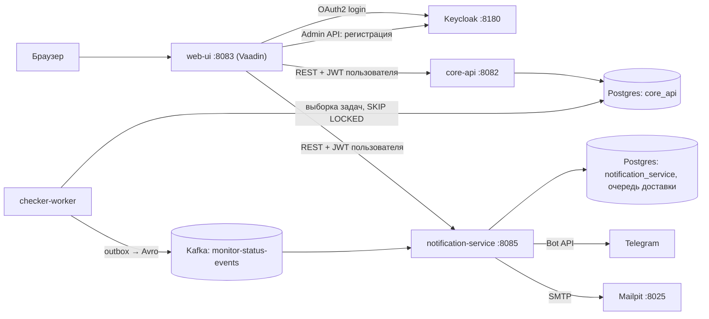

# Monitoring Platform

Платформа мониторинга доступности сайтов и SSL-сертификатов: пользователь заводит мониторы,
сервис периодически их проверяет, хранит историю и присылает уведомления о падении и
восстановлении в Telegram и на email. Каналы подключаются и выключаются самим пользователем.

Проект учебный и демонстрационный: цель — показать современный Java-стек и типовые
production-паттерны (OAuth2, transactional outbox, event-driven взаимодействие, очередь
доставки с повторами, идемпотентность, наблюдаемость), а не заменить готовые сервисы
вроде UptimeRobot.

## Статус

| Возможность | Состояние |
|---|---|
| Регистрация и вход через Keycloak (OAuth2 / OIDC) | ✅ |
| Создание, редактирование, пауза и удаление мониторов (лимит FREE: 5), проверка адреса при вводе | ✅ |
| HTTP-проверки (параллельно на virtual threads) и SSL-проверки (цепочка доверия, имя хоста, срок) | ✅ |
| Подтверждение сбоя: N проверок подряд с быстрыми повторами | ✅ |
| Автообновление статусов в интерфейсе | ✅ |
| Transactional outbox → Kafka (Avro + Schema Registry) | ✅ |
| Каналы уведомлений: Telegram и email, переключатели «получать / не получать», подтверждение адреса | ✅ |
| Очередь доставки: повторы с нарастающей паузой, сохранение порядка, независимость каналов | ✅ |
| Метрики (Prometheus) и дашборды (Grafana) для всех сервисов | ✅ |
| Сквозная трассировка (Zipkin): браузер → web-ui → core-api и проверка → outbox → Kafka → доставка | ✅ |
| Оповещения оператора: Grafana → email (9 правил) | ✅ |
| Unit- и интеграционные тесты (Testcontainers), CI в GitHub Actions | ✅ |
| История доставок в интерфейсе, выбор типов событий | ⏳ |
| DNS/WHOIS-проверка, отдельное предупреждение «SSL скоро истекает» | ⏳ |
| API Gateway, OpenAPI-контракты | ⏳ |

## Архитектура



| Модуль | Назначение |
|---|---|
| `common-events` | Avro-схема события `MonitorStatusEvent`, общий контракт сервисов |
| `core-api` | REST API мониторов, OAuth2 Resource Server (stateless), владелец схемы БД `core_api` |
| `checker-worker` | Выполняет проверки, пишет результаты и outbox, публикует события в Kafka. HTTP-порт (8084) только для служебных эндпоинтов actuator |
| `notification-service` | Принимает события, ведёт каналы пользователей, ставит уведомления в очередь и доставляет их (Telegram-бот, SMTP). Своя БД, OAuth2 Resource Server |
| `web-ui` | Vaadin-интерфейс, OAuth2 Client (stateful-сессия), регистрация через Keycloak Admin API, страница настроек уведомлений |
| `infra/` | Init-скрипт Postgres, realm Keycloak, конфигурации Prometheus и Grafana (дашборды, оповещения) |

## Как работает проверка и доставка

1. `checker-worker` раз в несколько секунд захватывает мониторы, которым пора проверяться
   (`SELECT ... FOR UPDATE SKIP LOCKED`), и сразу отодвигает им `next_check_at`.
2. Каждая проверка выполняется на отдельном virtual thread; результат пишется в `check_result`.
3. Сбой не меняет статус сразу: монитор перепроверяется через `retry-interval-seconds` (15 с),
   и DOWN наступает после `failure-threshold` сбоев подряд (3). Успех возвращает UP сразу.
4. При смене статуса в той же транзакции пишется событие в `outbox_event`. Первая успешная проверка
   нового монитора (`UNKNOWN` → `UP`) событие не создаёт: ничего не восстанавливалось.
5. Отдельный публикатор отправляет события в Kafka (at-least-once).
6. `notification-service` принимает событие и **только ставит его в очередь**: по строке на каждый
   включённый и исправный канал пользователя. Консьюмер сразу подтверждает сообщение, поэтому
   сбой внешнего канала не блокирует Kafka.
7. Воркер доставки берёт готовые строки (`SKIP LOCKED`, с арендой на время отправки) и отправляет их
   через канал. При временном сбое пауза растёт (10, 20, 40 ... до 600 секунд, до 10 попыток, около
   40 минут), затем строка получает статус `FAILED`. Постоянный сбой (бот заблокирован, адрес
   отклонён почтовым сервером) помечает канал сломанным, и пользователь видит причину.
8. Для одной пары «монитор + канал» новое уведомление не отправляется, пока есть более старое
   неотправленное: UP не обгонит DOWN. Другие мониторы и каналы при этом не блокируются.
9. Идемпотентность: уникальный ключ `(event_id, channel_type)` не даёт доставить одно событие дважды
   при повторной выдаче из Kafka.

Статусы строки очереди: `PENDING` (ждёт отправки или повтора), `SENT`, `FAILED`, `CANCELLED`
(пользователь выключил канал, пока строка ждала).

## Типы мониторов

| Тип | Что вводить | Что считается сбоем |
|---|---|---|
| `HTTP` | Полный адрес: `https://example.com/health` | Код вне 200–399, таймаут, ошибка соединения. Редиректы поддерживаются |
| `SSL` | `example.com` или `https://example.com` (порт всегда 443) | Недоверенный сертификат, несовпадение имени хоста, срок истёк или истекает менее чем через 14 дней |
| `DNS` | — | Не реализован: такие мониторы пропускаются |

## Каналы уведомлений

Страница «Настройки» содержит по карточке на канал. У каждого канала три независимых свойства:
**привязан ли он**, **выбор пользователя** (переключатель «получать / не получать») и
**состояние системы** (`ACTIVE`, `BROKEN`, `PENDING_VERIFICATION`). Включены оба канала, и
уведомление уходит в оба.

**Telegram.** Пользователь не вводит `chat_id`: нажимает «Подключить», получает одноразовую ссылку
`t.me/<бот>?start=<токен>` и нажимает Start в боте. Токен действует 10 минут, срабатывает один раз,
в БД хранится только его SHA-256. Бот принимает сообщения через long polling.

**Email.** Пользователь вводит адрес, на него уходит письмо со ссылкой `/verify-email?token=...`
(действует 24 часа, не чаще одного письма в минуту). Страница подтверждения открывается без входа
и подтверждает адрес **по нажатию кнопки**, а не при открытии: почтовые сервисы часто сами открывают
ссылки из писем, и токен сгорал бы раньше, чем человек увидит письмо. До подтверждения письма
не отправляются; при смене адреса старый перестаёт получать письма сразу, новый начинает после
подтверждения.

## Требования

JDK 21, Maven 3.9+, Node.js 18+ (Vaadin в dev-режиме собирает фронтенд) и Docker Desktop.
Docker нужен для инфраструктуры и для интеграционных тестов. Версия Testcontainers (1.21.4)
зафиксирована в корневом `pom.xml`: более старые версии не работают с Docker 29 и новее.
В корневом `pom.xml` включён флаг компилятора `-parameters` (`maven.compiler.parameters`):
без него Spring не определяет имена параметров методов контроллеров.

Все команды ниже выполняются из корня Maven-проекта — каталога, где лежат корневой `pom.xml`
и `docker-compose.yml`.

## Быстрый старт

```powershell
# 1. Инфраструктура: Postgres, Keycloak (realm импортируется сам), Kafka, Schema Registry, Kafka UI,
#    Zipkin, Prometheus, Grafana, Mailpit
docker compose up -d

# 2. Сборка всех модулей (common-events должен собраться первым — Maven сам упорядочит)
mvn clean install

# 3. Сервисы — каждый в своём окне терминала, в таком порядке:
#    core-api первым (он создаёт схему БД), notification-service до web-ui
cd core-api;             mvn spring-boot:run
cd checker-worker;       mvn spring-boot:run
cd notification-service; mvn spring-boot:run
cd web-ui;               mvn spring-boot:run
```

Откройте http://localhost:8083. Первый запуск `web-ui` долгий: Vaadin ставит npm-зависимости.

**Telegram-бот.** Создайте бота у @BotFather, затем:
- имя бота впишите в `notification-service/src/main/resources/application.yml` (`telegram.bot-username`);
- токен передайте переменной окружения `TELEGRAM_BOT_TOKEN`. В репозиторий токен не попадает.

**Почта.** По умолчанию письма уходят в локальный Mailpit и наружу не отправляются: читайте их
в веб-интерфейсе http://localhost:8025. Чтобы отправлять настоящую почту, задайте переменные
окружения `SMTP_*` (см. таблицу ниже); пароль хранится только в окружении, не в репозитории.

## Наблюдаемость

- **Zipkin** (http://localhost:9411): трассы запросов `web-ui` → `core-api` и сквозная цепочка
  `monitor.check` → `outbox.publish` → отправка в Kafka → приём → `alert.send`. Контекст трассировки
  проходит через outbox и очередь доставки (хранится в строках таблиц), поэтому цепочка не рвётся.
  Каждая строка лога содержит `[сервис,traceId,spanId]`, по `traceId` строку можно найти в Zipkin.
  Токен бота входит в адрес запроса к Telegram, поэтому этот клиент намеренно не трассируется
  автоматически (токен попал бы в трассы): отправка видна как ручной span `alert.send`.
- **Grafana** (http://localhost:3000): дашборды «Services overview» (HTTP, JVM, пул соединений) и
  «Monitoring business» (проверки, мониторы по статусам, очереди outbox и доставки, алерты,
  связь с Telegram, отставание Kafka). Источники данных (Prometheus, Zipkin) и дашборды
  настраиваются автоматически из `infra/grafana`.
- **Оповещения оператора.** Девять правил в Grafana (`infra/grafana/provisioning/alerting`):
  сервис недоступен, проверки не выполняются, большинство проверок неуспешны, уведомления не
  доставлены, нет связи с Telegram, застряла очередь доставки или outbox, отставание Kafka,
  всплеск ошибок в логах. Письма идут **напрямую из Grafana по SMTP**, а не через
  `notification-service`: если сломается именно он, об этом нужно узнать независимым путём.
  Правила из файлов нельзя править в интерфейсе: меняйте файл и перезапускайте Grafana.
- Метрики сервисов отдаются на `/actuator/prometheus`; Prometheus (http://localhost:9090)
  опрашивает их раз в 15 секунд.

## Ключевые решения

- **Keycloak — единственный источник идентичности.** Пользователь во всех сервисах определяется
  Keycloak `sub`. `web-ui` — OAuth2-клиент с сессией, `core-api` и `notification-service` —
  stateless Resource Server'ы, поэтому это отдельные модули.
- **Очередь задач поверх Postgres** (`SELECT ... FOR UPDATE SKIP LOCKED`): захват задачи (быстрая
  транзакция) отделён от её выполнения (медленный сетевой I/O), несколько воркеров не пересекаются.
  Тот же приём используется и для проверок мониторов, и для доставки уведомлений.
- **Transactional outbox.** Смена статуса и событие пишутся в одной транзакции, публикация в Kafka —
  отдельным шагом. Гарантия доставки at-least-once, обработка идемпотентна по `eventId`.
- **Консьюмер Kafka не отправляет уведомления сам.** Он только ставит их в очередь: сбой Telegram или
  почты не блокирует партицию Kafka и не задерживает другие каналы.
- **Подтверждение сбоя** защищает от ложных алертов при нестабильной сети, не откладывая
  уведомление на целые интервалы мониторинга.
- **Выбор пользователя и состояние системы хранятся раздельно** (`enabled` и `status`): интерфейс
  отличает «я выключил» от «сломалось».
- **Каналы подключаются реализацией интерфейса `ChannelSender`**: новый канал не требует
  менять планировщик и воркер доставки.
- **Привязка и подтверждение через одноразовые токены**: адресат от клиента без подтверждения
  не принимается, в БД хранится только SHA-256 токена.
- **Одна схема — один владелец.** Миграции `core_api` ведёт `core-api`; `checker-worker`
  использует ту же БД без собственных миграций (осознанное упрощение).
- **Адрес монитора проверяется дважды:** на сервере (источник истины) и в форме (быстрая обратная связь).

## Тесты

```powershell
mvn test -pl "!web-ui"
```

- **Unit-тесты** не требуют ни Docker, ни интернета: валидация адресов, форматирование сообщений,
  планировщик и воркер доставки (исходы, повторы, пауза), обработка команд бота, отправка почты и
  разбор её ошибок, HTTP- и SSL-проверки.
- **Интеграционные тесты** идут на настоящем Postgres в контейнере (Testcontainers) со схемой из
  миграций самих сервисов. `checker-worker`: захват задач (в том числе параллельными воркерами),
  порог неудач, outbox и его публикация. `notification-service`: очередь доставки (идемпотентность,
  аренда, порядок, параллельные воркеры), сквозной путь «планировщик → воркер», модель каналов,
  подтверждение email. Без Docker эти тесты пропускаются; с переменной окружения
  `REQUIRE_DOCKER=true` отсутствие Docker считается ошибкой (так настроен CI).
- `web-ui` тестами не покрыт, и в тестовой сборке исключён: его сборка запускает `npm install`.

## CI

Файл `.github/workflows/ci.yml`: на каждый push в `main` и каждый Pull Request выполняется
`mvn verify` без `web-ui` под JDK 21. Если репозиторий хранит Maven-проект во вложенном каталоге,
он указан в `defaults.run.working-directory` этого файла.

## Конфигурация

| Параметр | По умолчанию | Назначение |
|---|---|---|
| `checker.poll-interval-ms` | 5000 | Как часто воркер опрашивает БД |
| `checker.batch-size` | 50 | Сколько мониторов захватывается за раз |
| `checker.http-timeout-seconds` | 10 | Таймаут одной проверки |
| `checker.failure-threshold` | 3 | Сбоев подряд до статуса DOWN |
| `checker.retry-interval-seconds` | 15 | Пауза между повторными проверками при неподтверждённом сбое |
| `outbox.poll-interval-ms` / `outbox.batch-size` | 1000 / 100 | Публикация outbox в Kafka |
| `delivery.poll-interval-ms` | 2000 | Как часто воркер доставки берёт готовые строки очереди |
| `delivery.batch-size` | 20 | Сколько уведомлений берётся за раз |
| `delivery.max-attempts` | 10 | Попыток доставки до статуса `FAILED` |
| `delivery.initial-backoff-seconds` / `delivery.max-backoff-seconds` | 10 / 600 | Начальная и предельная пауза между попытками |
| `delivery.lease-seconds` | 120 | «Аренда» строки на время отправки (если воркер упал, строка вернётся в работу) |
| `notification.mail.from` (`MAIL_FROM`) | `no-reply@monitoring.local` | Адрес отправителя. Для настоящей почты замените на адрес своего домена |
| `notification.mail.web-base-url` (`WEB_UI_BASE_URL`) | `http://localhost:8083` | На этот адрес ведут ссылки в письмах |
| `notification.mail.verification-ttl-hours` | 24 | Срок действия ссылки подтверждения email |
| `notification.mail.resend-cooldown-seconds` | 60 | Пауза между письмами подтверждения |
| `telegram.bot-username` | — | Имя бота для ссылки привязки |

Переменные окружения:

| Переменная | По умолчанию | Назначение |
|---|---|---|
| `TELEGRAM_BOT_TOKEN` | — | Токен бота. Без него приём сообщений бота и доставка в Telegram отключены |
| `SMTP_HOST` / `SMTP_PORT` | `localhost` / `1025` | SMTP-сервер (по умолчанию Mailpit) |
| `SMTP_USERNAME` / `SMTP_PASSWORD` | — | Учётные данные SMTP |
| `SMTP_AUTH` / `SMTP_STARTTLS` | `false` / `false` | Нужны ли вход и шифрование |
| `MAIL_FROM`, `WEB_UI_BASE_URL` | см. выше | Отправитель писем и адрес ссылок |

## Порты

| Что | Порт |
|---|---|
| Postgres (хост → контейнер) | 5434 → 5432 |
| Keycloak | 8180 |
| Kafka (listener для приложений на хосте) | 9092 |
| Schema Registry | 8081 |
| Kafka UI | 8090 |
| Zipkin | 9411 |
| Prometheus | 9090 |
| Grafana | 3000 |
| Mailpit: SMTP / веб-интерфейс | 1025 / 8025 |
| core-api / web-ui / checker-worker / notification-service | 8082 / 8083 / 8084 / 8085 |

Базы в одном контейнере Postgres: `core_api`, `notification_service`, `keycloak`.

## Учётные данные для разработки

Всё ниже предназначено **только для локальной разработки** и лежит в репозитории осознанно.
В реальном проекте такие значения в git не хранят.

- Keycloak Admin Console: `admin` / `admin`, realm `monitoring-platform`
- Тестовый пользователь: `testuser` / `test1234`
- Grafana: `admin` / `admin` (http://localhost:3000)
- Клиенты (секреты в `infra/keycloak/realm-export.json`): `core-api-client`, `web-ui-client`, `web-ui-admin-client`

## Структура репозитория

```
.
├── pom.xml                  родительский pom
├── docker-compose.yml
├── infra/
│   ├── postgres-init/       создание баз данных
│   ├── keycloak/            realm-export.json
│   ├── prometheus/          prometheus.yml
│   └── grafana/             источники данных, дашборды, оповещения
├── common-events/           Avro-контракт
├── core-api/
├── checker-worker/
├── notification-service/
└── web-ui/
```

## Типичные проблемы

- **Порт занят** (5432, 8081, 8080): измените публикуемый порт в `docker-compose.yml` и URL в `application.yml`.
- **`docker compose down -v` удаляет данные ВСЕХ сервисов**, а не одного: том Postgres общий.
  После него realm Keycloak и базы пересоздаются автоматически, пользователи и мониторы — нет.
- **Realm не обновился после правки `realm-export.json`**: импорт срабатывает только на пустой БД Keycloak.
- **`Account is not fully set up` при входе**: у пользователя в Keycloak должны быть заполнены имя и фамилия.
- **Ошибка в `*.sh` на Windows**: проверьте, что в файле переводы строк LF (за это отвечает `.gitattributes`).
- **`Name for argument of type ... not specified`** в контроллере: не включён флаг `-parameters`
  (`maven.compiler.parameters` в корневом `pom.xml`) либо IDE собрала модуль без него.
- **Алерты не приходят**: проверьте, что канал подключён под тем же пользователем, которому принадлежит
  монитор, переключатель включён, а для Telegram `TELEGRAM_BOT_TOKEN` передан процессу
  `notification-service`. Статус доставки виден в таблице `notification_delivery`.
- **Письма не приходят в настоящую почту**: по умолчанию они остаются в Mailpit (http://localhost:8025).
- **Ссылка из письма ведёт не туда**: задайте `WEB_UI_BASE_URL`.
- **Тесты падают с `Could not find a valid Docker environment` или `client version 1.32 is too old`**:
  Docker 29+ поднял минимальную версию API, нужен Testcontainers 1.21.4 или новее
  (проверьте импорт `testcontainers-bom` в корневом `pom.xml`: он должен стоять до `spring-boot-dependencies`).
- **Интеграционные тесты показывают `Skipped`**: Docker не найден.
- **В CI ошибка `Could not find the selected project in the reactor`**: в рабочем каталоге нет корневого `pom.xml`;
  проверьте `working-directory` в `ci.yml`.
- **Grafana не стартует после правки оповещений**: смотрите `docker logs monitoring-grafana`; формат файлов
  правил зависит от версии Grafana.
- **`web-ui` на запросе метрик возвращает HTML**: в `pom.xml` нет `micrometer-registry-prometheus`.

## Известные ограничения

- В интерфейсе нет истории доставок: данные есть в таблице `notification_delivery`, но не показаны.
- Строки очереди доставки не удаляются автоматически, `check_result` растёт без ограничений
  (нет ротации и срока хранения).
- Устаревшие объекты ещё не удалены: таблица `processed_event`, колонка `user_channel.is_active`.
- Email: поддерживаются только адреса из ASCII-символов, письма — простой текст без оформления.
  Работа с настоящим SMTP-сервером не проверялась, разработка идёт на Mailpit.
- «SSL скоро истекает» (менее 14 дней) сейчас трактуется как DOWN, отдельного предупреждения нет;
  SSL проверяется только на порту 443, дата истечения в интерфейсе не показывается.
- Время в уведомлениях — в UTC.
- Правило оповещения «Проверки не выполняются» предполагает, что интервал мониторов меньше 20 минут.
  Пороги остальных правил подобраны по смыслу и требуют подстройки на реальной нагрузке.
- Оповещения живут внутри Grafana: если упадёт она сама, никто об этом не узнает.
- Отправка в Telegram не повторяется для постоянных сбоев; для канала это означает, что пользователю
  нужно подключить его заново.
- В `web-ui` нет аккуратного перехода на повторный вход при истечении сессии Keycloak;
  он не покрыт тестами и не собирается в CI.
- Предупреждение Avro про `logicalType` в `monitor-status-event.avsc` безвредно, но не исправлено.

## Работа с Git

- `main` — всегда собирающаяся рабочая версия. Напрямую в неё не коммитим.
- Каждое изменение — в своей ветке `feature/<что-делаем>`, `fix/<что-чиним>`, `test/<что-тестируем>`
  или `docs/<что-описываем>`, затем Pull Request в `main`.
- Сообщения коммитов в стиле Conventional Commits: `feat: ...`, `fix: ...`, `test: ...`, `docs: ...`,
  `refactor: ...`, `chore: ...`.
- Один PR — одна законченная мысль.
