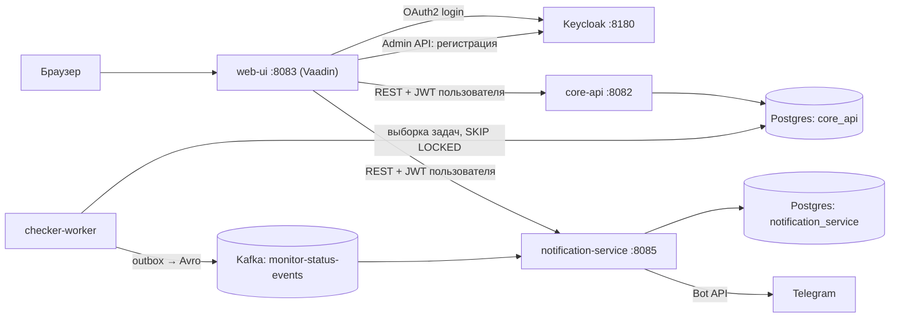

# Monitoring Platform

Платформа мониторинга доступности сайтов и SSL-сертификатов: пользователь заводит мониторы,
сервис периодически их проверяет, хранит историю и присылает алерты в Telegram.

Проект учебный и демонстрационный: цель — показать современный Java-стек и типовые
production-паттерны (OAuth2, transactional outbox, event-driven взаимодействие, идемпотентность),
а не заменить готовые сервисы вроде UptimeRobot.

## Статус

| Возможность | Состояние |
|---|---|
| Регистрация и вход через Keycloak (OAuth2 / OIDC) | ✅ |
| Создание, редактирование, пауза и удаление мониторов (лимит FREE: 5), проверка адреса при вводе | ✅ |
| HTTP-проверки, параллельно на virtual threads | ✅ |
| SSL-проверки: цепочка доверия, имя хоста, срок действия | ✅ |
| Подтверждение сбоя: N проверок подряд с быстрыми повторами | ✅ |
| Автообновление статусов в UI | ✅ |
| Transactional outbox → Kafka (Avro + Schema Registry) | ✅ |
| Telegram: привязка на странице «Настройки», алерты, идемпотентная доставка | ✅ |
| Unit-тесты | ✅ |
| Интеграционные тесты (Testcontainers) и CI | ⏳ |
| DNS/WHOIS-проверка, отдельное предупреждение «SSL скоро истекает», API Gateway, OpenAPI-контракты | ⏳ |

## Архитектура



| Модуль | Назначение |
|---|---|
| `common-events` | Avro-схема события `MonitorStatusEvent`, общий контракт сервисов |
| `core-api` | REST API мониторов, OAuth2 Resource Server (stateless), владелец схемы БД `core_api` |
| `checker-worker` | Выполняет проверки, пишет результаты и outbox, публикует события в Kafka. HTTP-порта нет |
| `notification-service` | Читает события, привязка каналов, Telegram-бот и доставка алертов. Своя БД, OAuth2 Resource Server |
| `web-ui` | Vaadin-интерфейс, OAuth2 Client (stateful-сессия), регистрация через Keycloak Admin API |
| `infra/` | Init-скрипт Postgres и realm Keycloak для автоимпорта |

## Как работает проверка

1. `checker-worker` раз в несколько секунд захватывает мониторы, которым пора проверяться
   (`SELECT ... FOR UPDATE SKIP LOCKED`), и сразу отодвигает им `next_check_at`.
2. Каждая проверка выполняется на отдельном virtual thread; результат пишется в `check_result`.
3. Сбой не меняет статус сразу: монитор перепроверяется через `retry-interval-seconds` (15 с),
   и DOWN наступает после `failure-threshold` сбоев подряд (3). Успех возвращает UP сразу.
4. При смене статуса в той же транзакции пишется событие в `outbox_event`.
5. Отдельный публикатор отправляет события в Kafka (at-least-once).
6. `notification-service` находит Telegram-канал владельца монитора и шлёт сообщение;
   таблица `processed_event` не даёт доставить одно событие дважды.

## Типы мониторов

| Тип | Что вводить | Что считается сбоем |
|---|---|---|
| `HTTP` | Полный адрес: `https://example.com/health` | Код вне 200–399, таймаут, ошибка соединения. Редиректы поддерживаются |
| `SSL` | `example.com` или `https://example.com` (порт всегда 443) | Недоверенный сертификат, несовпадение имени хоста, срок истёк или истекает менее чем через 14 дней |
| `DNS` | — | Не реализован: такие мониторы пропускаются |

## Ключевые решения

- **Keycloak — единственный источник идентичности.** Пользователь во всех сервисах определяется
  Keycloak `sub`. `web-ui` — OAuth2-клиент с сессией, `core-api` и `notification-service` —
  stateless Resource Server'ы, поэтому это отдельные модули.
- **Очередь задач поверх Postgres:** захват задачи (быстрая транзакция) отделён от её выполнения
  (медленный сетевой I/O), несколько воркеров не пересекаются.
- **Transactional outbox.** Смена статуса и событие пишутся в одной транзакции, публикация в Kafka —
  отдельным шагом. Гарантия доставки at-least-once, консьюмеры идемпотентны по `eventId`.
- **Подтверждение сбоя** защищает от ложных алертов при нестабильной сети, не откладывая
  уведомление на целые интервалы мониторинга.
- **Привязка Telegram через deep-link.** `chat_id` от клиента не принимается. Токен привязки
  одноразовый, живёт 10 минут, в БД хранится только его SHA-256.
- **Одна схема — один владелец.** Миграции `core_api` ведёт `core-api`; `checker-worker`
  использует ту же БД без собственных миграций (осознанное упрощение).
- **Адрес монитора проверяется дважды:** на сервере (источник истины) и в форме (быстрая обратная связь).

## Требования

JDK 21, Maven 3.9+, Docker Desktop, Node.js 18+ (Vaadin в dev-режиме собирает фронтенд).

## Быстрый старт

```powershell
# 1. Инфраструктура: Postgres, Keycloak (realm импортируется сам), Kafka, Schema Registry, Kafka UI
docker compose up -d

# 2. Сборка всех модулей (common-events должен собраться первым — Maven сам упорядочит)
mvn clean install

# 3. Сервисы — каждый в своём окне терминала
cd core-api;             mvn spring-boot:run
cd checker-worker;       mvn spring-boot:run
cd notification-service; mvn spring-boot:run
cd web-ui;               mvn spring-boot:run
```

Откройте http://localhost:8083. Первый запуск `web-ui` долгий: Vaadin ставит npm-зависимости.

**Telegram-бот.** Создайте бота у @BotFather, затем:
- имя бота впишите в `notification-service/src/main/resources/application.yml` (`telegram.bot-username`);
- токен передайте переменной окружения `TELEGRAM_BOT_TOKEN`. В репозиторий токен не попадает;
- в приложении откройте «Настройки» и нажмите «Подключить Telegram».

## Тесты

```powershell
mvn test
```

Unit-тесты не требуют ни Docker, ни интернета: валидация адресов, форматирование и доставка алертов
(идемпотентность, отключение канала), обработка команд бота, HTTP- и SSL-проверки.

## Конфигурация

| Параметр | По умолчанию | Назначение |
|---|---|---|
| `checker.poll-interval-ms` | 5000 | Как часто воркер опрашивает БД |
| `checker.batch-size` | 50 | Сколько мониторов захватывается за раз |
| `checker.http-timeout-seconds` | 10 | Таймаут одной проверки |
| `checker.failure-threshold` | 3 | Сбоев подряд до статуса DOWN |
| `checker.retry-interval-seconds` | 15 | Пауза между повторными проверками при неподтверждённом сбое |
| `outbox.poll-interval-ms` / `outbox.batch-size` | 1000 / 100 | Публикация outbox в Kafka |
| `telegram.bot-username` | — | Имя бота для ссылки привязки |
| `TELEGRAM_BOT_TOKEN` (окружение) | — | Токен бота. Без него приём сообщений и доставка отключены |

## Порты

| Что | Порт |
|---|---|
| Postgres (хост → контейнер) | 5334 → 5432 |
| Keycloak | 8180 |
| Kafka (listener для приложений на хосте) | 9092 |
| Schema Registry | 8081 |
| Kafka UI | 8090 |
| Zipkin (поднят, пока не используется) | 9411 |
| core-api / web-ui / notification-service | 8082 / 8083 / 8085 |

Базы в одном контейнере Postgres: `core_api`, `notification_service`, `keycloak`.

## Учётные данные для разработки

Всё ниже предназначено **только для локальной разработки** и лежит в репозитории осознанно.
В реальном проекте такие значения в git не хранят.

- Keycloak Admin Console: `admin` / `admin`, realm `monitoring-platform`
- Тестовый пользователь: `testuser` / `test1234`
- Клиенты (секреты в `infra/keycloak/realm-export.json`): `core-api-client`, `web-ui-client`, `web-ui-admin-client`

## Структура репозитория

```
.
├── pom.xml                  родительский pom
├── docker-compose.yml
├── infra/
│   ├── postgres-init/       создание баз данных
│   └── keycloak/            realm-export.json
├── common-events/           Avro-контракт
├── core-api/
├── checker-worker/
├── notification-service/
└── web-ui/
```

## Типичные проблемы

- **Порт занят** (5432, 8081, 8080): измените публикуемый порт в `docker-compose.yml` и URL в `application.yml`.
- **`docker compose down -v` удаляет данные ВСЕХ сервисов**, а не одного: том Postgres общий.
  После него realm Keycloak и базы пересоздаются автоматически, пользователи и мониторы — нет.
- **Realm не обновился после правки `realm-export.json`**: импорт срабатывает только на пустой БД Keycloak.
- **`Account is not fully set up` при входе**: у пользователя в Keycloak должны быть заполнены имя и фамилия.
- **Ошибка в `*.sh` на Windows**: проверьте, что в файле переводы строк LF (за это отвечает `.gitattributes`).
- **Алерты не приходят**: проверьте, что Telegram подключён под тем же пользователем, которому принадлежит
  монитор, и что `TELEGRAM_BOT_TOKEN` передан процессу `notification-service`.

## Известные ограничения

- Нет интеграционных тестов и CI.
- Алерт теряется, если Telegram недоступен дольше минуты (dead-letter топика ещё нет), а пока идут
  повторы, стоит партиция Kafka.
- «SSL скоро истекает» (менее 14 дней) сейчас трактуется как DOWN, отдельного предупреждения нет;
  SSL проверяется только на порту 443, дата истечения в интерфейсе не показывается.
- `check_result` растёт без ограничений: нет ротации партиций и срока хранения.
- Время в алертах — в UTC.
- В `web-ui` нет аккуратного перехода на повторный вход при истечении сессии Keycloak.
- Предупреждение Avro про `logicalType` в `monitor-status-event.avsc` безвредно, но не исправлено.

## Работа с Git

- `main` — всегда собирающаяся рабочая версия. Напрямую в неё не коммитим.
- Каждое изменение — в своей ветке `feature/<что-делаем>`, `fix/<что-чиним>`, `test/<что-тестируем>`
  или `docs/<что-описываем>`, затем Pull Request в `main`.
- Сообщения коммитов в стиле Conventional Commits: `feat: ...`, `fix: ...`, `test: ...`, `docs: ...`,
  `refactor: ...`, `chore: ...`.
- Один PR — одна законченная мысль.
